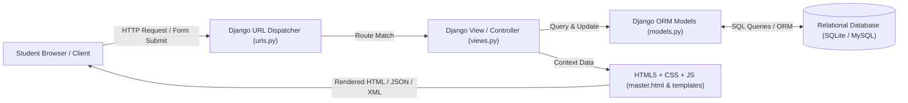
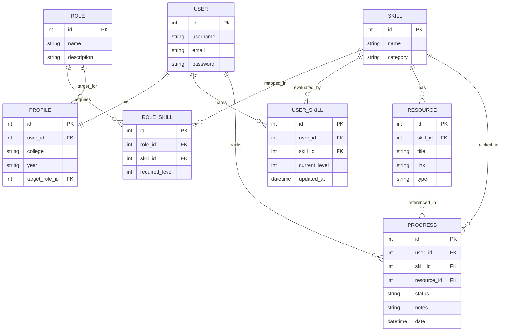
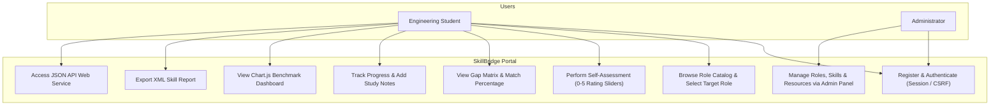
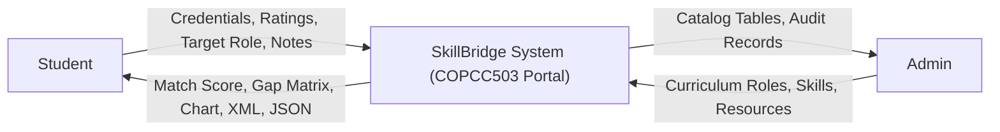
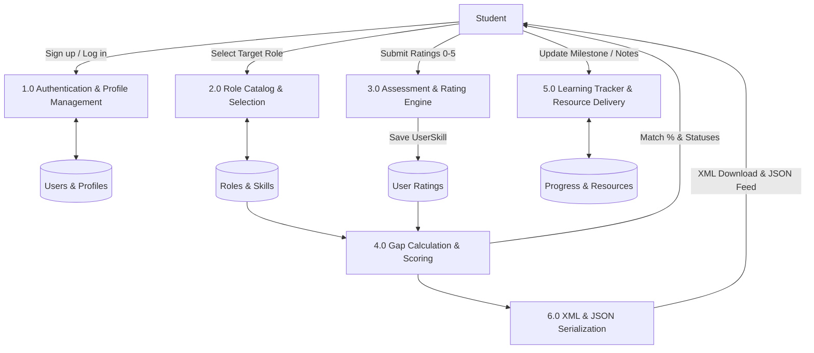
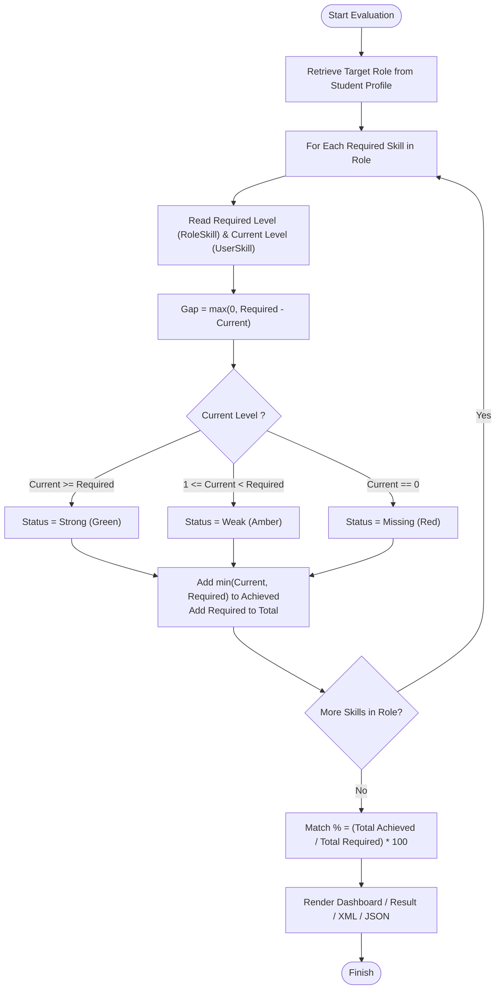

# SkillBridge: Project Report & Viva Reference Guide

**Course:** Web Technology (COPCC503)  
**Academic Year:** 2026–2027  
**Class:** Third Year Computer Engineering (TE), Semester VI  
**Institute:** AISSMS Institute of Information Technology (IOIT), Pune  
**Project Title:** SkillBridge: A Web Portal for Career Skill Mapping and Learning Progress Tracking  

---

## 1. Abstract
The transition from academic engineering curricula to industry employment requires students to possess demonstrable proficiencies in specialized technical competencies. Students often lack clarity regarding specific industry benchmarks, leading to skill misalignments. **SkillBridge** is a database-backed, responsive web portal developed to bridge this gap. Built using the Model-View-Template (MVT) architecture with Python, Django, HTML5, CSS3, JavaScript (DOM), and relational databases (SQLite/MySQL), SkillBridge enables engineering students to benchmark their current abilities against curated job roles (such as Full Stack Developer, Data Analyst, and Android Engineer), evaluate quantifiable gap metrics, visualize comparisons via interactive Chart.js visualizations, access targeted learning resources, and export standardized XML reports and JSON endpoints.

---

## 2. Problem Statement & Objectives
### Problem Statement
Traditional computer engineering academic curricula focus on foundational concepts, creating a discrepancy between theoretical classroom knowledge and dynamic industry requirements. Engineering students often lack continuous feedback mechanisms to benchmark their current competencies against real-world job roles and systematically track their remedial learning progress.

### Objectives
1. Provide a role and skill catalog mapped against real industry requirements.
2. Deliver a self-assessment engine allowing students to rate their competencies on a standardized 0–5 proficiency scale.
3. Compute an instantaneous, deterministic gap analysis identifying Strong, Weak, and Missing skills along with an overall Role Match Score.
4. Provide a personalized learning tracker linking gap skills directly to curated study resources (courses, documentation, videos, books).
5. Visualize competency benchmarks dynamically through Chart.js charts.
6. Provide XML skill report export (Unit III) and JSON RESTful web services (Unit IV).
7. Demonstrate dual-database flexibility using SQLite during development and MySQL for production.

---

## 3. System Architecture & Diagrams

### 3.1 Django MVT (Model-View-Template) Architecture

---

### 3.2 Entity-Relationship (ER) Diagram

---

### 3.3 Use Case Diagram

---

### 3.4 Data Flow Diagram (DFD)

#### Level 0 DFD (Context Diagram)

#### Level 1 DFD

---

### 3.5 Skill Mapping & Gap Logic Flowchart

---

## 4. Syllabus Mapping (Web Technology COPCC503)

| Unit | Topic in Syllabus | SkillBridge Implementation |
|---|---|---|
| **Unit I** | HTML5 & CSS3 | Semantic HTML5 structure, responsive flexbox/grid layout, modern typography (Plus Jakarta Sans, JetBrains Mono), CSS custom properties, styled cards, forms, tables, progress indicators. |
| **Unit II** | JavaScript & DOM Manipulation | Dynamic DOM element creation and removal (`Add Extra Skill`), client-side form validation, real-time slider value updates, zero-reload table status filters (All/Missing/Weak/Strong), live inline match percentage recalculation, Chart.js canvas rendering. |
| **Unit III** | XML & Schemas | Clean XML generation using `xml.etree.ElementTree` and `minidom`. Generates downloadable `skillbridge_report_<username>.xml` containing metadata, competency metrics, and skill-wise breakdown. |
| **Unit IV** | Web Services & JSON | RESTful JSON endpoints (`/api/skills/` and `/api/result/`) returning standardized JSON payloads for mobile apps, external clients, and decoupled dashboard consumption. |
| **Unit V** | Database Connectivity | Django Object-Relational Mapper (ORM) replacing verbose JDBC boilerplate. Provides query abstraction, migration tracking, parameterized SQL security against SQL injection, and multi-backend support. |
| **Unit VI** | Django Framework | Project settings, MVT design pattern, single app (`core`), URL router, Jinja-style template tags (`extends`, `include`, `for`, `if`, `url`, `static`, `csrf_token`), Django Session Authentication, Django Admin with TabularInlines. |

---

## 5. Viva Voce Revision Guide

### Q1: What is the MVT architecture in Django?
**Answer:** Django follows Model-View-Template (MVT):
- **Model:** Represents database tables and business entities using Python classes (`core/models.py`). Handles ORM interactions and validations.
- **View:** The business controller that receives HTTP requests, interacts with models/services, and selects a template to render (`core/views.py`).
- **Template:** The presentation layer containing HTML5 with embedded Django template tags (`templates/master.html`, `core/templates/core/*.html`).

### Q2: How does Django replace JDBC?
**Answer:** In Java EE, JDBC requires writing manual connection pools, SQL strings, `PreparedStatement`, `ResultSet` mappings, and exception handlers. Django provides an **Object-Relational Mapper (ORM)** where database tables are defined as Python classes. The ORM automatically translates Python querysets (e.g. `Role.objects.all()`) into optimized SQL dialect for the configured database backend (SQLite, MySQL, PostgreSQL), completely eliminating raw boilerplate and guarding against SQL injection.

### Q3: How is the Skill Gap and Match Percentage calculated?
**Answer:** For each skill required by the target role:
1. `required_level` (1 to 5) is retrieved from `RoleSkill`.
2. `current_level` (0 to 5) is retrieved from `UserSkill` (defaults to 0 if unrated).
3. `gap = max(0, required_level - current_level)`.
4. Status:
   - **Strong:** `current_level >= required_level`
   - **Weak:** `1 <= current_level < required_level`
   - **Missing:** `current_level == 0`
5. $\text{Match Percentage} = \frac{\sum \min(\text{current}, \text{required})}{\sum \text{required}} \times 100$.

### Q4: What is CSRF and how does SkillBridge protect against it?
**Answer:** Cross-Site Request Forgery (CSRF) is an attack where an unauthorized site submits malicious commands from an authenticated user's browser. Django enforces CSRF protection using the `` template tag inside all POST forms, generating a cryptographic session token that is validated by `CsrfViewMiddleware`.

### Q5: How do SQLite and MySQL differ in SkillBridge?
**Answer:**
- **SQLite:** A serverless, zero-configuration file-based relational database (`db.sqlite3`) used during development and automated testing for rapid turnaround.
- **MySQL:** A client-server relational DBMS suited for multi-user production deployments. SkillBridge seamlessly transitions between both via `USE_MYSQL` in `settings.py` and `PyMySQL`.
